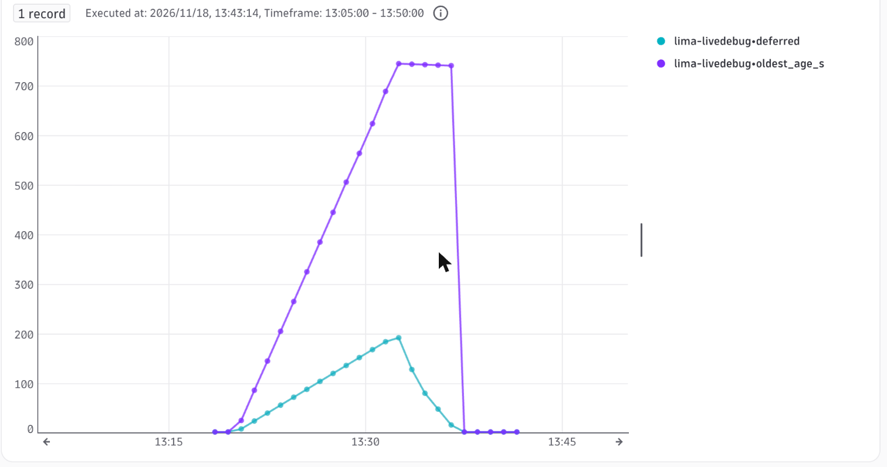
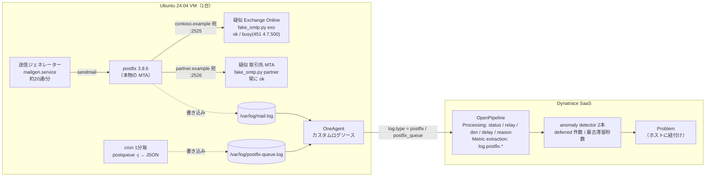
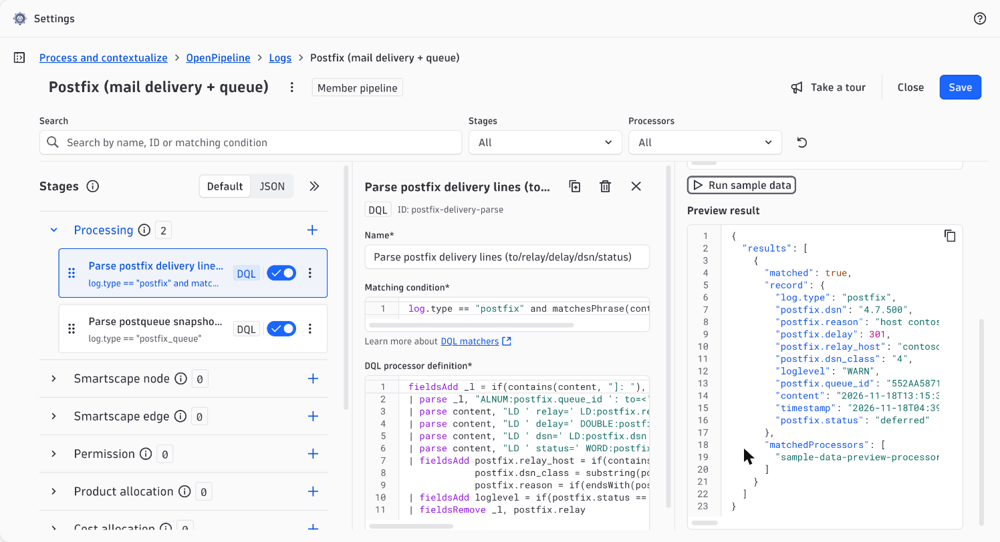
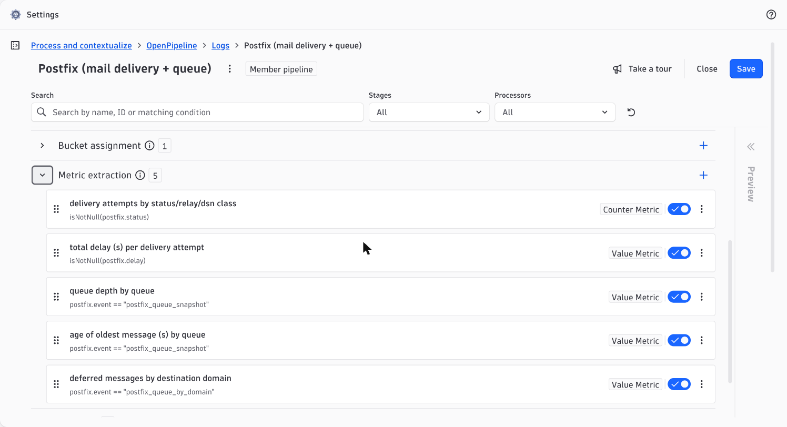
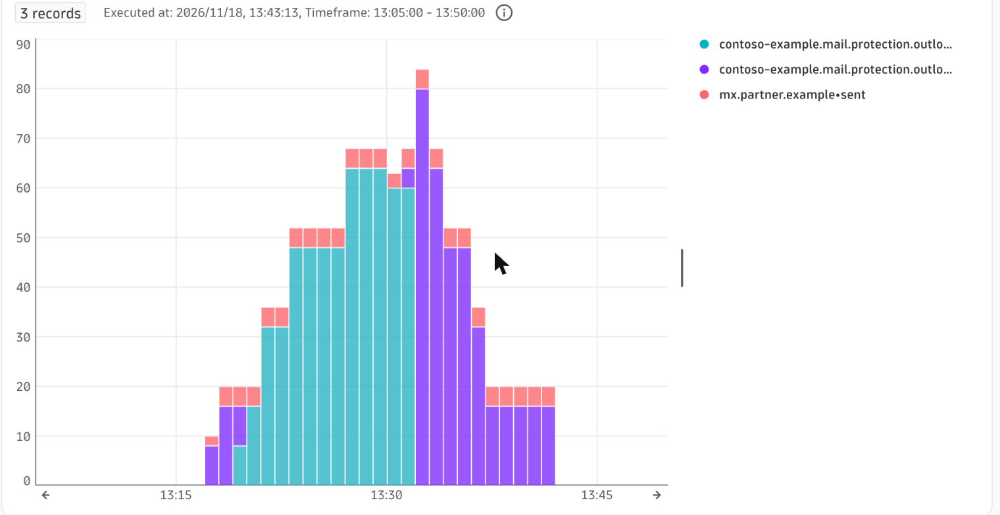
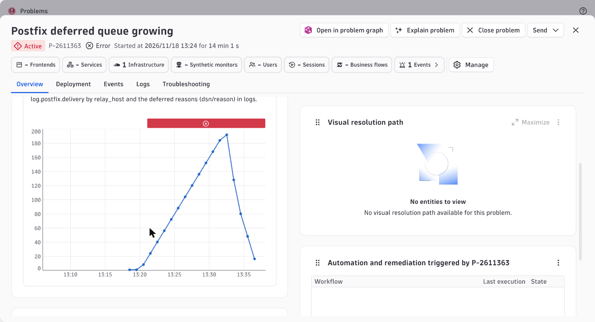

# Postfix deferred キューを Dynatrace で監視する（検証ラボ）

上流の Microsoft 365（Exchange Online）が一時エラーを返し続ける状況を再現し、postfix の deferred キューの増加を Dynatrace で検知・調査できるかを確かめたラボです。

- postfix の配送ログ（maillog）と、`postqueue -j` で取ったキュー状態を OneAgent でログとして取り込む
- OpenPipeline でログを項目に分解し、メトリクス（`log.postfix.*`）を取り出す
- Davis の anomaly detector（静的しきい値）で Problem にする



## 何が本物で、何が疑似か

| 区分 | 内容 |
|---|---|
| 本物 | postfix 3.8.6（Ubuntu 24.04 のパッケージ）、キューと再送の挙動、ログの書式、OneAgent によるログの取り込み |
| 疑似 | 送信先の Exchange Online と取引先 MTA。[`lab/fake_smtp.py`](lab/fake_smtp.py)（約60行）が応答を返す。`/etc/fakesmtp/<name>.mode` で `ok` / `busy`（`451 4.7.500 Server busy`）/ `tempfail`（`421`）/ `slow` / `reject`（`550`）を切り替える。応答文は Exchange Online の一時エラーを模したもの |
| 短縮 | 再送間隔を短くした。`queue_run_delay` と `minimal_backoff_time` は 60 秒（既定 300 秒）、`maximal_backoff_time` は 300 秒（既定 4000 秒）。送信量は約 20 通/分 |
| 追加 | [`lab/queue_snapshot.sh`](lab/queue_snapshot.sh)。1分ごとに `postqueue -j` を集計し、JSON を1行ずつ出す。postfix 標準の機能ではなく、mailq の件数監視に当たる部分 |

## 構成



| メトリクス | 内容 |
|---|---|
| `log.postfix.delivery` | 配送試行の件数（status × relay × dsn 区分 × ホスト） |
| `log.postfix.delivery.delay` | 配送試行ごとの遅延（秒） |
| `log.postfix.queue.messages` | queue 別の件数 |
| `log.postfix.queue.oldest_age_s` | queue 別の最古メールの滞留秒数 |
| `log.postfix.queue.deferred_by_domain` | deferred の宛先ドメイン別件数 |

すべて1台の VM に同居させています。postfix から見ると、疑似 Exchange Online と疑似取引先 MTA は `/etc/hosts` で 127.0.0.1 に向けた別ホスト名の中継先です。

送信経路は `transport_maps` で2つに分けています。

| 宛先ドメイン | 中継先 | 役 |
|---|---|---|
| `contoso.example` | `contoso-example.mail.protection.outlook.com`（:2525） | Exchange Online |
| `partner.example` | `mx.partner.example`（:2526） | M365 を通らない取引先 MTA |

## OpenPipeline

配送結果の行は、項目ごとに独立した `parse` で取り出します。ファイル経由と journald 経由で行頭の形式が違うことや、`orig_to=`・`conn_use=` が入る行があることに対応するためです。定義は [`dynatrace/openpipeline-logs-pipeline.json`](dynatrace/openpipeline-logs-pipeline.json) にあります。





## 結果

Exchange Online 役を 13:19:33 JST に `busy` に切り替え、12 分後に `ok` に戻しました。取引先側は正常のままです。

- deferred の件数はピークで 192 通（13:35）。復旧後、キューは 13:37 に 0 に戻った
- 最古メールの滞留はピークで 745 秒。最も遅れたメールは 782 秒後に配送された
- deferred になった配送試行は 592 回。すべて `contoso-example.mail.protection.outlook.com` で、`dsn=4.7.500`
- 取引先経路（`mx.partner.example`）は期間中ずっと `sent` だった

配送試行の結果を relay と status で分けたグラフです。水色が M365 経路の deferred、紫が M365 経路の sent、赤が取引先経路の sent です。M365 経路だけが詰まり、復旧後に再送分がまとめて送られていることが分かります。



### アラート

anomaly detector は2本です（[`dynatrace/`](dynatrace/)）。どちらも 5 分中 3 分しきい値を超えたら発火し、5 分続けて下回ったら解除します。`dt.source_entity` にホストの ID を入れてホストに紐付けています。

| 名前 | クエリ | しきい値（ラボ用） |
|---|---|---|
| Postfix deferred queue growing | `max(log.postfix.queue.messages)`、deferred | 20 通 |
| Postfix deferred message delayed | `max(log.postfix.queue.oldest_age_s)`、deferred | 300 秒 |

障害開始から約 8 分後の 13:27 頃に Problem が起票されました。



## 実環境に持ち込むときの注意

- **maillog の取り込み元を1つに絞る。** このラボ（Ubuntu、取り込みルールは全ログを取り込む設定）では、`/var/log/mail.log` は自動では取り込まれず、カスタムログソースとして登録しました。一方で同じ postfix の行が `/var/log/syslog` と journald からも入り、3重になっていました。件数を数えるなら1つに絞ります（ここでは `log.type` でルーティングし、mail.log だけを使いました）。RHEL 系の `/var/log/maillog` でも同じ確認が必要です。
- **メールアドレスのマスキング。** このテナントのマスキング設定で `to=<...>` は `<Masked_email>` になり、ログから宛先ドメインは取れませんでした。代わりに relay ホスト名と、キュー状態の JSON（ドメインだけを出す）を使いました。宛先ドメイン別に見たいなら、マスキングの方針と合わせて決めます。
- **キュー件数はログに出ない。** ログに出るのは1通ごとの配送結果です。今の件数は `postqueue` などで別に取る必要があります。このラボではログとして送りましたが、OneAgent のローカル metric API でメトリクスとして直接送る方法もあります（このラボの VM ではそのポートが開いていなかったため使いませんでした）。ログ経由なら、ホストに API トークンを置かずに済みます。
- **しきい値は平常時を見て決める。** 上のしきい値はラボ用です。平常時の deferred 件数と滞留時間を見てから決めます。

## ログの取り込み方法（Dynatrace SaaS）

[ログ取り込みのドキュメント](https://docs.dynatrace.com/docs/analyze-explore-automate/logs/lma-log-ingestion)の選択肢のうち、postfix サーバーに関係するものです。

| 方法 | 使いどころ |
|---|---|
| [OneAgent](https://docs.dynatrace.com/docs/analyze-explore-automate/logs/lma-log-ingestion/lma-log-ingestion-via-oa) | postfix サーバーに入れられるなら第一候補。このラボはこれ |
| [Syslog（ActiveGate 経由）](https://docs.dynatrace.com/docs/analyze-explore-automate/logs/lma-log-ingestion/lma-log-ingestion-syslog) | OneAgent を入れられない場合。Linux の Environment ActiveGate が UDP 514 / TCP 601（RFC 5424）で受ける。rsyslog から `mail.*` だけを送れる |
| [Log ingestion API](https://docs.dynatrace.com/docs/analyze-explore-automate/logs/lma-log-ingestion/lma-log-ingestion-via-api) | Fluent Bit などから HTTP で送る場合 |

どの経路で入れても、OpenPipeline の処理は同じです。

## 再現手順

1. Ubuntu 24.04 の VM（OneAgent 導入済み）に postfix を入れる（`apt install postfix mailutils jq`）
2. `lab/` を置き、そのディレクトリで `sudo ./setup_vm.sh` を実行する。疑似 SMTP 2つ、送信ジェネレーター、cron、`/etc/hosts`、`transport_maps` を設定する
3. Dynatrace に `dynatrace/` の設定を作る
   - カスタムログソース（`builtin:logmonitoring.custom-log-source-settings`、HOST スコープ）
   - ログのパイプライン（`builtin:openpipeline.logs.pipelines`）と、ルーティングの先頭への1行追加（`builtin:openpipeline.logs.routing`）
   - anomaly detector 2本（`builtin:davis.anomaly-detectors`）
4. 障害を起こす: `echo busy | sudo tee /etc/fakesmtp/exo.mode`。戻す: `echo ok | sudo tee /etc/fakesmtp/exo.mode`

## 調査に使った DQL

```
// deferred の理由
fetch logs
| filter log.type == "postfix" and postfix.status == "deferred"
| summarize attempts = count(), first = min(timestamp), last = max(timestamp), by: {postfix.relay_host, postfix.dsn, postfix.reason}

// 同じメールの再送の経過
fetch logs
| filter log.type == "postfix" and isNotNull(postfix.queue_id)
| summarize tries = count(), deferred = countIf(postfix.status == "deferred"), sent = countIf(postfix.status == "sent"),
            max_delay_s = max(postfix.delay), by: {postfix.queue_id, postfix.relay_host}
| filter deferred > 0
| sort max_delay_s desc
```
